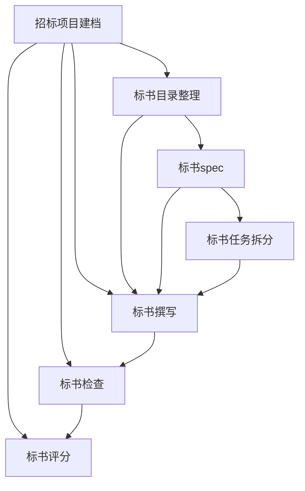

# BidCoPilotSkills

面向中国招投标场景的可复用标书技能库。项目把招标材料识别、标书设计、Markdown 初稿编制、独立检查和评分核对串成一条可交接的工作链。

## 仓库

- GitHub：https://github.com/monaChoy/BidCoPilotSkills
- Git：https://github.com/monaChoy/BidCoPilotSkills.git

## 给 Agent 的安装提示词

把下面这段原样发给 Agent，让它从本仓库安装技能包：

```text
请从 https://github.com/monaChoy/BidCoPilotSkills.git 安装 BidCoPilotSkills 标书技能包。

安装要求：
1. 克隆或拉取该仓库的最新内容。
2. 把仓库中每个技能目录（含 SKILL.md 及同目录配套文件）安装到通用 Agent 技能目录 ~/.agents/skills/<技能名>/，或当前运行环境约定的等价目录。
3. 不要安装到某个具体投标项目目录。本仓库是技能维护源，多个项目应复用同一套技能。
4. 需要安装的技能：招标项目建档、标书目录整理、标书spec、标书任务拆分、标书撰写、标书检查、标书评分。
5. 安装后核对每个技能目录都有 SKILL.md；招标项目建档还需包含 AGENTS模板.md。
6. 安装完成后列出实际安装路径。
```

## 技能链

按需求选择入口，不要求所有项目串行运行七个技能：



| 需求 | 流程 |
| --- | --- |
| 已有标书，需要审核 | 建档 → 检查 |
| 直接起草 | 建档 → 撰写 → 全套完成后检查 |
| 先设计内容策略 | 建档 → 目录 → spec → 撰写 → 检查 |
| 分批或多人交接 | 在设计后增加任务拆分；局部任务完成不等于全套完成 |
| 核对评分或估分 | 建档 → 评分；估分需明确要求 |

- `招标项目建档`：按内容确认招标文字卷、图纸、清单、澄清和事实素材，登记必要的重复关系与哈希；生成文件不触发反复建档。
- `标书目录整理`：建立来源覆盖、全量 REQ 要求索引、已核 BOQ 清单和当前有效目录，只声明结构覆盖，允许多个清单行共用响应章节。
- `标书spec`：复用 REQ/BOQ 基线记录当前有效策略和章节设计；待核项只阻塞受影响内容，整体冻结仍有明确条件。
- `标书任务拆分`：按可交付章节拆分，保存 REQ/BOQ 范围、真实依赖、素材位置和续接状态。
- `标书撰写`：直接或按已有设计起草Markdown，分章保存响应 ID、进度及待补；直接局部撰写不强制先建目录。
- `标书检查`：独立、只读检查，复用有效 REQ/BOQ 基线验证正文证据，按批保存正常和异常项，支持阶段性检查和中断续查。
- `标书评分`：独占评分规则提取和评分判断，为目录提供结构核对、为检查提供正文评分分支；明确要求时模拟评分。

## 目录结构

```text
BidCoPilotSkills/
├── 招标项目建档/
│   ├── SKILL.md
│   └── AGENTS模板.md
├── 标书目录整理/
│   └── SKILL.md
├── 标书spec/
│   └── SKILL.md
├── 标书任务拆分/
│   └── SKILL.md
├── 标书撰写/
│   └── SKILL.md
├── 标书检查/
│   └── SKILL.md
├── 标书评分/
│   └── SKILL.md
└── README.md
```

每个技能目录以 `SKILL.md` 为入口；`AGENTS模板.md` 是建档技能创建项目档案时使用的配套模板。

## 使用约定

- 新项目先建档；来源无实质变化直接复用，不为新增报告或正文重建档。
- 各产物记录输入版本、当前有效状态和下一步，换对话从文件恢复，不靠长对话记忆。
- 清单、目录和spec仅复用有效版本；旧决策明确失效，同名输入变化要重新核对影响。输入未变且清单有效时复用基线，不强制重新逐行提取。
- REQ 是跨技能要求 ID，BOQ 是跨技能清单行 ID；撰写与检查沿用有效基线，报告的 C 核对 ID 和 P 问题 ID 不替代基线 ID。无有效基线时，检查使用 C、原行标识和来源位置，不另发 REQ/BOQ；后续建立或修复目录基线时按原行和来源映射。
- 目录的“结构覆盖完成”只表示已有标题、表格、附件或人工事项落点；“正文覆盖完成”须由检查依据实质证据判断。
- 检查先确定模式和全套/阶段性范围；阶段性结果不冒充全套结论。
- 检查优先使用不继承撰写对话的子代理；不支持时询问是否接受非独立检查，并标明限制。
- 无须安装外部访谈技能；七个技能及建档模板构成完整技能包。

如果通过指令让 Agent 部署这些技能，建议安装到通用的 Agent 技能目录 `~/.agents/skills/<技能名>/`（或当前运行环境约定的等价目录），不要放入某个具体投标项目目录，以便多个项目复用；本仓库作为技能维护源。

技能运行时的项目档案、初稿和报告放在具体投标项目的 `投标输出/<项目名>/` 中；本仓库只维护技能定义，不存放真实项目运行产物。

## 共同边界

- 以完整招标文件及有效澄清文件为要求和评分依据，不用通用模板替代原文。
- 投标人资质、业绩、人员、参数和承诺只能来自用户确认的事实素材，不补造事实。
- `标书检查` 只读标书，问题需有相应证据：要求与响应、缺失项的已查范围，或内部冲突的两处位置；不可读附件和外部状态保留待核。
- 当前输出重点是 Markdown 内容与检查报告，不包含 Word/PDF 排版、签章、密封、CA、平台上传和最终递交操作。
- 检查报告是辅助核查结果，不承诺“检查通过”即不会被否决或一定中标。

## 维护

技能正文使用中文，固定字段名和必要工具名按运行环境保留。修改技能时优先复用现有交接契约和术语，避免把项目管理、递交操作或未经验证的自动化规则加入技能链。

维护时先编辑本仓库，再同步七个技能目录及模板到实际运行目录，逐文件比较确认一致。不要将真实投标材料或验证结果安装为通用技能资源。检查报告保存全量核对行，但不复制整份原文，也不引入OCR缓存。
