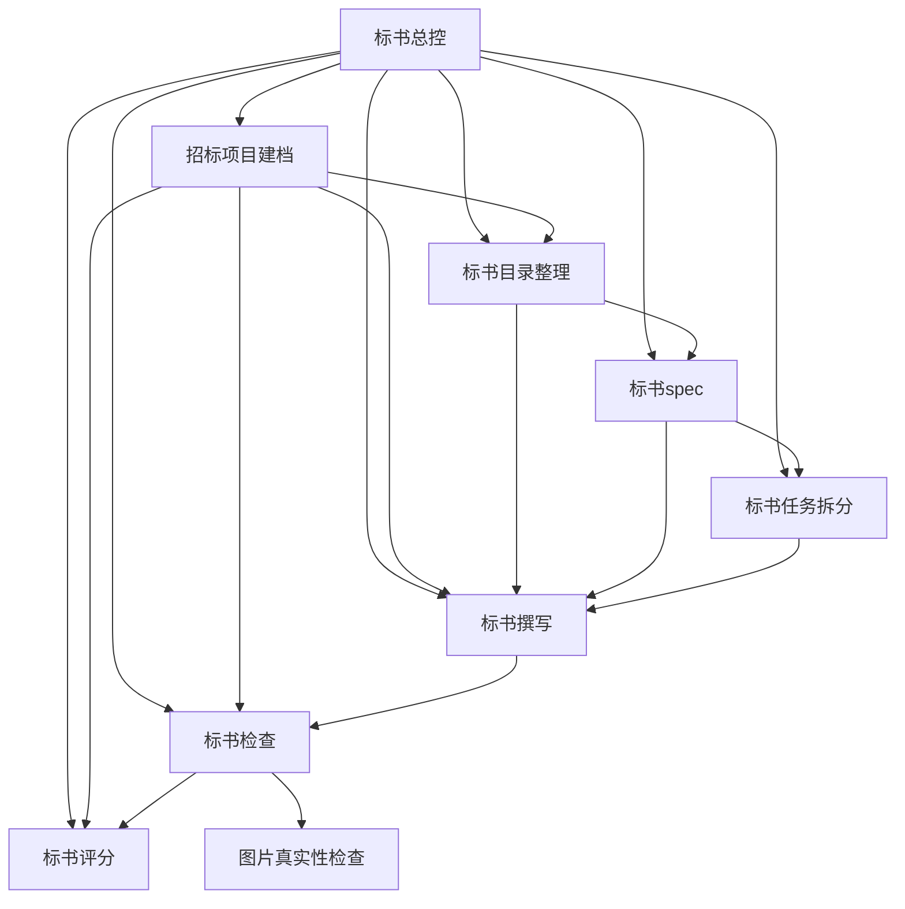

# BidCoPilotSkills

面向中国招投标场景的可复用标书技能库。项目把招标材料识别、标书设计、Markdown 初稿编制、独立检查和评分核对串成一条可交接的工作链；并提供总控入口，降低「技能太多、不知从哪开始」的选用成本。

本技能包含 **总控 + 7 个子技能**（共 8 个可安装技能）及建档模板。

## 仓库

- GitHub：https://github.com/monaChoy/BidCoPilotSkills
- Git：https://github.com/monaChoy/BidCoPilotSkills.git

## Quickstart

装好技能后，用自然语言触发即可。示例：

| 你想说的话 | 通常触发 | 第一份产物 |
| --- | --- | --- |
| 「我有一份招标文件在 `某路径`，帮我建档」 | `bid-project-setup`（或先经 `bid-orchestrator`） | 项目 `AGENTS.md` |
| 「帮我按这份招标直接起草技术标」 | 建档（若无）→ `bid-writing` | `投标输出/<项目>/正文/` 章节 + `撰写进度.md` |
| 「帮我审这份标书 / 查合规和废标风险」 | 建档（若无）→ `bid-review` | `投标输出/<项目>/标书检查报告-*.md` |

记不清从哪开始时说「标书从哪开始」或「下一步做什么」，优先触发 `bid-orchestrator`。

## 给 Agent 的安装提示词

把下面这段原样发给 Agent，让它从本仓库安装技能包：

```text
请从 https://github.com/monaChoy/BidCoPilotSkills.git 安装 BidCoPilotSkills 标书技能包。

安装要求：
1. 克隆或拉取该仓库的最新内容（建议保留为维护源，用软链接挂到技能目录，便于日后 git pull 更新）。
2. 把仓库中每个技能目录（含 SKILL.md 及同目录配套文件）安装到当前运行环境的用户级技能目录（见下方「各运行环境技能目录」）；推荐以 ~/.agents/skills/<技能名>/ 为规范副本，再按需软链到 Cursor / Claude Code 目录。
3. 不要安装到某个具体投标项目目录。本仓库是技能维护源，多个项目应复用同一套技能。
4. 需要安装的标书技能：标书总控、招标项目建档、标书目录整理、标书spec、标书任务拆分、标书撰写、标书检查、标书评分。
5. 图片真实性伴随技能为 image-authenticity-review，确认其已安装在 ~/.agents/skills/image-authenticity-review/，且 SKILL.md、references 和 scripts 完整；缺失时明确告知用户，不从其他来源静默安装。
6. 安装后核对每个标书技能目录都有 SKILL.md 和 agents/openai.yaml；招标项目建档还需包含 AGENTS模板.md。
7. 安装完成后列出实际安装路径。
```

### 各运行环境技能目录

| 运行环境 | 用户级（全局）目录 | 说明 |
| --- | --- | --- |
| Cursor | `~/.cursor/skills/` 与 `~/.agents/skills/` | 二者均会加载；Cloud Agents 同步通常针对 `~/.cursor/skills/` |
| Claude Code | `~/.claude/skills/` | 项目级亦可放 `.claude/skills/` |
| Codex | `~/.agents/skills/` | 旧路径 `~/.codex/skills/` 可能仍可读，优先用 `.agents` |
| 通用 / 多环境 | `~/.agents/skills/` | 建议作规范副本，再软链到上表各目录 |

推荐：克隆本仓后对每个技能目录执行 `ln -s <仓库路径>/<技能名> ~/.agents/skills/<技能名>`（以及需要的 `~/.cursor/skills`、`~/.claude/skills`），更新时在仓库内 `git pull` 即可，无需逐文件复制。

## 技能链

按需求选择入口，不要求所有项目串行运行全部技能。不确定入口时先用 `bid-orchestrator`；**选型细则以 `bid-orchestrator` 正文路由表为准**（此处不重复维护需求对照表）。图片真实性检查是 `bid-review` 的伴随分支：



- `bid-orchestrator`：编排入口；判断当前阶段、推荐下一步子技能；不写正文、不审标、不替代子技能细则。
- `bid-project-setup`（招标项目建档）：确认招标、澄清和事实材料，说明 PDF/Word 如何得到正文读取文件，登记必要的重复关系与哈希；生成文件不触发反复建档。
- `bid-outline`（标书目录整理）：建立来源覆盖、全量 REQ 要求索引、已核 BOQ 清单和当前有效目录，有无正式工程量清单均可；只声明结构覆盖，允许多个清单行共用响应章节。
- `bid-spec`（标书spec）：复用 REQ/BOQ 基线记录当前有效策略和章节设计；待核项只阻塞受影响内容，整体冻结仍有明确条件。
- `bid-task-breakdown`（标书任务拆分）：按可交付章节拆分，保存 REQ/BOQ 范围、真实依赖、材料位置和续接状态。
- `bid-writing`（标书撰写）：直接或按已有设计起草 Markdown；章节在 `正文/`，进度在 `撰写进度.md`；全套完成后由主上下文收齐检查参数再派独立检查。
- `bid-review`（标书检查）：独立、只读检查；先读 `撰写进度.md` 定位投标文件集，复用有效 REQ/BOQ 基线验证正文证据；支持综合模式与单项（引用/内部矛盾）范围，核对企业及人员证件、证书和授权/担保等时效，默认提示检查日后 15 天内到期的证件，标准/完整模式自动触发图片真实性检查。
- `bid-scoring`（标书评分）：按原文检查结构或正文，为目录提供结构核对、为检查提供正文评分分支；明确要求时模拟评分，同样可先读撰写进度清单定位文件。
- `image-authenticity-review`（图片真实性检查）：已安装在 `~/.agents/skills/image-authenticity-review/` 的独立伴随技能，检查 PS 编辑、拼接、改字及 AI 生成/重绘线索，输出独立报告和证据图；不复制进本仓库，不据此直接认定造假。

## 目录结构

```text
BidCoPilotSkills/
├── 标书总控/
│   └── SKILL.md
├── 招标项目建档/
│   ├── SKILL.md
│   └── AGENTS模板.md
├── 标书目录整理/
│   └── SKILL.md
├── 标书spec/
│   └── SKILL.md
├── 标书任务拆分/
│   └── SKILL.md
├── 标书撰写/
│   └── SKILL.md
├── 标书检查/
│   └── SKILL.md
├── 标书评分/
│   └── SKILL.md
└── README.md
```

每个技能目录以 `SKILL.md` 为入口；`AGENTS模板.md` 是建档技能创建项目档案时使用的配套模板。`SKILL.md` 的 `name` 是英文调用标识，`agents/openai.yaml` 提供中文显示名和短说明；中文目录名保持不变，显式调用使用英文 ID，中文自然语言请求仍按 `description` 匹配。

## 使用约定

- 各技能的 `description` 用中文任务意图区分总控、建档、目录、设计、拆分、撰写、检查和评分；具体执行规则以技能正文为准。
- 勘察设计、咨询、监理、检测等没有正式工程量清单的项目，可用原文中的功能等价清册；确认确无清单时，按招标范围、服务任务、成果和评分要求建立目录与响应索引，不虚构清单行数，仍核对适用的报价要求。
- 新项目先建档；来源无实质变化直接复用，不为新增的报告或正文重新建档。PDF/Word 招标文件需有「正文读取文件」（见建档技能）；扫描件不做全文 OCR。
- 各产物记录输入版本、当前有效状态和下一步，换对话从文件恢复，不靠长对话记忆。
- 清单、目录和spec仅复用有效版本；旧决策明确失效，同名输入变化要重新核对影响。输入未变且清单有效时复用基线，不强制重新逐行提取。
- REQ 是跨技能要求 ID，BOQ 是跨技能清单行 ID；撰写与检查沿用有效基线，报告的 C 核对 ID 和 P 问题 ID 不替代基线 ID。无有效基线时，检查使用 C、原行标识和来源位置，不另发 REQ/BOQ；后续建立或修复目录基线时按原行和来源映射。
- 目录的“结构覆盖完成”只表示已有标题、表格、附件或人工事项落点；“正文覆盖完成”须由检查依据实质证据判断。
- 综合检查先确定模式和全套/阶段性范围，单项检查按明确类别限定范围；阶段性和单项结果都不冒充全套结论。
- 撰写后检查必须使用不继承撰写对话的独立子代理；派发前由主上下文问清「检查模式 + 是否模拟评分」并传入子代理。无法创建独立检查时标明「未完成独立检查」。仅在用户单独调用检查、且无子代理能力时，才可询问是否接受非独立检查并标明限制。
- 规范引用与前后矛盾的核对由 `bid-review` 按单项范围完成，单项结果不代表全套已检查。
- 无须安装外部访谈技能；总控、七个标书子技能及建档模板由本仓库维护，图片真实性检查复用已安装的 `image-authenticity-review`。标准/完整检查中该伴随技能不可用或应检未检时，主报告不得声称全部检查已完成。

技能运行时的项目档案、初稿和报告放在具体投标项目的 `投标输出/<项目名>/` 中（章节默认 `正文/`，进度清单为 `撰写进度.md`）；本仓库只维护技能定义，不存放真实项目运行产物。

## 共同边界

- 以完整招标文件及有效澄清文件为要求和评分依据，不用通用模板替代原文。
- 投标人资质、业绩、人员、参数和承诺只能来自用户确认的事实材料，不补造事实。
- `bid-review` 只读标书，问题需有相应证据：要求与响应、缺失项的已查范围，或内部冲突的两处位置；不可读附件和外部状态保留待核。
- 当前输出重点是 Markdown 内容与检查报告，不包含 Word/PDF 排版、签章、密封、CA、平台上传和最终递交操作。
- 检查报告只是辅助核查结果："检查通过"不代表不会被否决，也不保证中标。

## 维护

技能正文使用中文，固定字段名和必要工具名按运行环境保留。修改技能时优先复用现有交接契约和术语，避免把项目管理、递交操作或未经验证的自动化规则加入技能链。

维护时先编辑本仓库；若以软链接安装，`git pull` 后运行目录即更新。若为拷贝安装，再同步总控与各子技能目录及模板到实际运行目录并逐文件比较。`image-authenticity-review` 是独立维护的伴随技能，不复制其源码或验证产物进本仓库。不要将真实投标材料或验证结果安装为通用技能资源。检查报告保存全量核对行，但不复制整份原文，也不引入 OCR 缓存。
